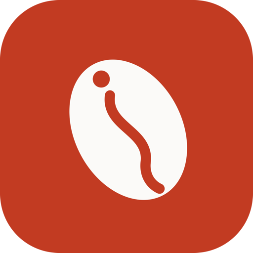
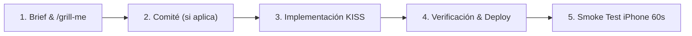

# BeanTag — Master Brand, Art Direction & Workflow Brief (2027/2028)

<p align="center">
  
</p>

> **Propósito:** Biblia viva de marca, dirección artística, comité multidisciplinario y proceso operativo estándar (SOP) de **BeanTag** — copiloto móvil-first de café de especialidad, cava criogénica, hardware BLE y etiquetas NFC.

---

## 1. Visión de Marca y Posicionamiento

**BeanTag** une dos mundos que rara vez conviven bien en una app:
- **La calidez artesanal del café de tercera ola** (tostadores boutique de Tokio, Copenhague y Melbourne, papel fino, cerámica, color dictado por el tueste y notas sensoriales SCA).
- **La precisión instrumental del laboratorio barista** (micrones físicos $D_{50}$, 8 molinos calibrados, control de válvulas de 3 fases, balanza Timemore Dot BLE en tiempo real y desgasificación/congelación criogénica).

**Promesa del ritual (Intent-First):**
> `Abrir → Elegir → Preparar → Ajustar` — en menos toques, con una sola mano y sin muros innecesarios.

**Qué NO es BeanTag:**
- No es una red social con feeds infinitos ni métricas adictivas.
- No es un formulario pesado de inventario CRUD.
- No depende de suscripciones cerradas ni se bloquea si cae internet (el motor físico barista opera offline).

---

## 2. Identidad Visual y Logo Oficial (`BeanTag 2028`)

### 2.1 Anatomía del Símbolo (Brand Mark)
El isotipo oficial de BeanTag ([logo.svg](../frontend/public/logo.svg)) sintetiza **un grano de café de especialidad** y **un punto de anclaje NFC / etiqueta**:
- **Forma base:** Elipse orgánica (`rx="29" ry="40"`) inclinada a **`-28°`** sobre eje central `(50, 50)`.
- **Surco central:** Trazo fluido en S (`stroke-width="5.5"`, `stroke-linecap="round"`) que evoca la fisura natural del grano tostado.
- **Punto superior (`r="4.6"` en `y=21`):** Representa el ojal de la etiqueta física (*hang-tag*) y el núcleo táctil del tag NFC.
- **Color insignia:** **Cereza Cafeto `#C23B22`** sobre lienzo **Crema `#FBFAF8`**.

### 2.2 Especificación SVG Canónica
```xml
<svg xmlns="http://www.w3.org/2000/svg" viewBox="0 0 100 100" role="img" aria-label="BeanTag">
  <g transform="rotate(-28 50 50)">
    <ellipse cx="50" cy="52" rx="29" ry="40" fill="#C23B22"/>
    <path d="M50 31 C 40 45, 60 58, 50 72 C 46 78, 47 84, 50 88"
          fill="none" stroke="#FBFAF8" stroke-width="5.5" stroke-linecap="round"/>
    <circle cx="50" cy="21" r="4.6" fill="#FBFAF8"/>
  </g>
</svg>
```

### 2.3 Variaciones y Reglas de Uso
| Variante | Relleno grano | Trazo y punto | Cuándo usarla |
| :--- | :--- | :--- | :--- |
| **Principal (Brand)** | `#C23B22` (Cereza) | `#FBFAF8` (Crema) | AppBar, PWA (`logo-192.png`, `logo-512.png`), tarjetas claras y presentaciones. |
| **Icono iOS / Sideloadly** | `#C23B22` sobre fondo `#FBFAF8` plano | `#FBFAF8` | `AppIcon-512@2x.png` (`1024×1024`, **RGB sin canal alfa** obligatorio para Xcode/Sideloadly). |
| **Adaptativa (Temas)** | `var(--brand)` o `var(--accent)` | `var(--surface)` | Header dinámico dentro de la app (`App.jsx`). |
| **Oscuro / Kissa** | `#E2A96F` (Ámbar dorado) | `#151210` (Espresso) | Tarjetas exportables nocturnas (`Kissa`) y piezas sobre fondos oscuros. |
| **Monocromo / Sello** | `#1A1714` o `#FFF6E6` | Transparente / fondo | Stickers transparentes, tickets térmicos y estampas minimalistas. |

- **Zona de respeto mínima:** `15%` del ancho del isotipo alrededor de los cuatro lados.
- **No hacer:** No rotar a un ángulo distinto de `-28°`, no añadir sombras duras estilo neo-brutalista, ni exportar el icono iOS con transparencia.

---

## 3. Dirección Artística 2027/2028 (*Warm Neo-Tactile Editorial*)

### 3.1 Principios Visuales
1. **Elevación tonal sin ruido de bordes:** Jerarquía por contraste de superficie (`--bg` → `--surface` → `--fill`), eliminando bordes dobles y "cajas dentro de cajas".
2. **Gramática Full-Pill orgánica:** Radio `var(--r-pill)` (`9999px`) unificado en botones primarios, secundarios, FAB, chips de estado y barra de navegación flotante.
3. **Liquid / Adaptive Glass quirúrgico:** Translúcido con desenfoque y borde especular superior (`inset 0 1px 0 var(--glass-edge)`) reservado exclusivamente para chrome flotante (`.bt-nav`, `.bt-sticky-cta`, `.app-header` sin línea divisoria rígida).
4. **Color dictado por el grano y la cata:** Auras ambientales sutiles (`8–10%`) según el nivel de tueste (`Claro #C98A3E`, `Medio #8E5226`, `Oscuro #4B2A1A`) y notas de cata coloreadas semánticamente con la rueda SCA (`getScaColorForNote`).
5. **Respeto estricto a tokens:** Cero valores `rgba(...)` de acento hardcodeados; todo componente debe respirar igual en cualquiera de los 17 temas.

### 3.2 Sistema Tipográfico
| Rol | Familia | Uso y reglas |
| :--- | :--- | :--- |
| **Display Editorial** | `Bricolage Grotesque` | Nombres de cafés, encabezados de vista. Eje óptico variable activo (`font-variation-settings: "opsz" 72`, tracking `-0.03em`). |
| **Editorial Serif (Tarjetas)** | `Playfair Display` | Títulos en tarjetas exportables *Kissa*, *Cerámica* y *Collage*. |
| **Lectura / UI** | `Inter` | Textos de pasos, etiquetas, controles y formularios. |
| **Datos e Instrumentación** | `JetBrains Mono` | Toda cifra (dosis, agua, tiempo, clics, micras, SCA, peso BLE) con `font-variant-numeric: tabular-nums`. |

### 3.3 Iconografía Custom (`CoffeeIcons.jsx`)
Se eliminaron emojis Unicode de la UI interactiva en favor de `lucide-react` y **13 iconos SVG vectoriales propios** diseñados para especialidad (`V60Icon`, `PulsarIcon`, `AeroPressIcon`, `ChemexIcon`, `EspressoIcon`, `FrenchPressIcon`, `OrigamiIcon`, `SwitchIcon`, `HandGrinderIcon`, `ElectricGrinderIcon`, `CoffeeScaleIcon`, `CoffeeBeanIcon`, `QuickAiIcon`).

### 3.4 Colección de 17 Temas Oficiales (`tokens.css` & `theme.js`)
| Familia | Temas | Fondo base | Acento |
| :--- | :--- | :--- | :--- |
| **Sistema** | `Automático` | Dinámico | `#8E5226` |
| **Claros Clásicos & Nórdicos** | `Crema`, `Nórdico`, `Porcelana` | `#FAF9F7` · `#F6F9FC` · `#F4F8FC` | `#8E5226` · `#1D5B8C` · `#285C84` |
| **Claros Botánicos & Japoneses** | `Matcha Uji`, `Sakura`, `Yuzu Crema`, `Gesha Floral`, `Lavanda`, `Terracota` | `#F7FAF6` · `#FDF6F8` · `#FCFBF2` · `#FCF9FA` · `#F7F4FC` · `#FAF4EE` | `#2D6A4F` · `#C95476` · `#A97810` · `#B23A58` · `#6D4C9E` · `#B84A2E` |
| **Oscuros de Cafetería & OLED** | `Tueste`, `Bosque`, `Cobre`, `Borgoña`, `Medianoche`, `Kissaten`, `Espresso OLED` | `#1C1815` · `#101915` · `#151517` · `#1B1115` · `#101423` · `#161E29` · `#000000` | `#E0A46A` · `#62BA90` · `#D88557` · `#DE6D88` · `#7E9CF8` · `#F2A65A` · `#E68A45` |

> Además, `BrewGuideModal` incorpora un toggle de 1 toque a **Modo Barra OLED** (`.mode-barra`) sin obligar a abandonar el tema diurno.

### 3.5 Colección de 8 Tarjetas Exportables (`stickerCards.js` & `storyCards.js`)
Diseñadas para Instagram Stories (vertical `960×1280`, horizontal `1280×720`, transparentes u opacas, con o sin receta):
1. **Kissa** *(Oscuro nocturno japonés, marco fino dorado, `Playfair Display` + `JetBrains Mono`)*
2. **Cerámica** *(Papel lino artesanal `#F7F0E6`, terracota, doble marco editorial)*
3. **Botánico** *(Salvia ceremonial `#EEF4EE`, verde matcha, barra superior limpia)*
4. **Etiqueta** *(Hang-tag clásica con ojillo y franja del color de tueste)*
5. **Origen** *(Mapa topográfico generativo por lote + altitud hero)*
6. **Tipográfica** *(Editorial moderna sobre papel claro con acento azul)*
7. **Collage** *(Zine artesanal con sello SCA y tipografía manuscrita)*
8. **Lata** *(Inspirada en latas craft de especialidad en verde bosque + naranja)*

---

## 4. Comité Multidisciplinario de BeanTag (6 Sillas Permanentes)

BeanTag evolucionó gracias a **12 auditorías especializadas** que hoy se consolidan en **6 sillas permanentes**. Cada silla tiene un mandato claro, aportes verificados en producción y reglas precisas de cuándo convocarla:

| Silla | Visión y Manifiesto | Aportes clave ya integrados | Cuándo convocarla |
| :--- | :--- | :--- | :--- |
| **1. Barista Profesional** | *"La física manda: ninguna receta bonita sirve si desborda la cámara o sugiere una molienda imposible."* | Capacidad física por método y advertencia automática de **Bypass** (AeroPress Go `210 ml`, AeroPress `250 ml`, Pulsar Mini `400 ml`); preparación previa *Antes de 0:00*; técnica explícita por paso (émbolo, válvula 3 fases, costra); calibración en micras para 8 molinos + detección de canalización en `sensoryTuner.js`. | Cambios en `aiEngine.js`, `grinders.js`, `sensoryTuner.js`, `QuickBrewView` o nuevos métodos de extracción. |
| **2. Director de Arte & Marca** | *"Cada píxel debe oler a bolsa de especialidad de Tokio o Copenhague, nunca a software corporativo genérico."* | Isotipo `BeanTag 2028` (`-28°`), reemplazo de emojis por `CoffeeIcons.jsx` (13 SVGs custom), armonización de tarjetas exportables (nuevos estilos *Kissa*, *Cerámica*, *Botánico*), notas SCA con color semántico real y auras de tueste en pantalla. | Nuevos temas, tarjetas exportables, iconos, assets de App Store/iOS o cambios de identidad. |
| **3. Agente UI 2027/2028** | *"Elevación tonal antes que bordes; tipografía variable y cifras tabulares antes que cajas anidadas."* | Limpieza de colisiones CSS, unificación **Full-Pill**, eliminación de doble borde en `--shadow-1/--shadow-2`, eje óptico `opsz`, erradicación de glows rojos hardcodeados en `BrewGuideModal` y steppers compactos `[ − | + ]`. | Rediseños de componentes, ajustes de CSS/tokens, revisión de contraste en los 17 temas. |
| **4. Agente UX Ritual & Densidad** | *"A las 7:30 AM con las manos mojadas, cada toque y cada píxel de scroll extra es fricción."* | Reducción de ~230 px antes del CTA en `BatchDetail`, CTA sticky al pulgar en portal, Cava *Intent-First* (*Siguiente taza* + filtros colapsados), BLE global (`TimemoreScaleContext`), controles `≥44px` en barra, botón *Repetir* en `BrewHistory` y eliminación del logout accidental en el avatar. | Nuevos flujos, navegación, formularios, ergonomía móvil `390×844` o integración de hardware BLE. |
| **5. Cliente de Cafetería / Invitado NFC** | *"Escanear un frasco ajeno debe sentirse como leer una carta de especialidad impecable, nunca un muro de login."* | Entrada pública directa sin login a `/batch/:id`, banner claro de solo lectura, cero acciones destructivas visibles para invitados, y puente `beantag://` en Safari iOS sin afectar a invitados sin la app ni a otros tags NFC. | Cambios en rutas `/batch/:id`, modo invitado, etiquetas NFC, QR o flujos de compartir. |
| **6. Arquitectura, iOS & QA** | *"El código más pequeño que resuelve el problema real, verificado con scripts y libre de bugs en iOS WebKit."* | Cascada automática Gemini (`2.5-flash-lite` → `2.5-flash` → `3-flash-preview`) + Groq, `createPortal` para sticky bars en iOS Safari, toggles React en vez de `<details>` dentro de `<form>`, `beantag://` en `Info.plist`/`SceneDelegate.swift` para Sideloadly, CI GitHub Actions en Node 24 y suites `verify_grinders.mjs` / `verify_cards_render.mjs`. | Cambios de backend, APIs IA, Capacitor/iOS, despliegue VPS o bugs de rendimiento/WebKit. |

---

## 5. Flujo Estándar de Trabajo (SOP en 5 Fases)



### Fase 1 · Definición y `/grill-me`
- Enunciar el objetivo en 1 frase + pantallas afectadas.
- Si hay decisiones de diseño o flujo, correr `/grill-me` (1 pregunta a la vez, opción recomendada primero) y convocar únicamente a las sillas pertinentes del Comité.

### Fase 2 · Reglas de Implementación (Blindaje iOS / WebKit)
- `position: fixed` dentro de vistas animadas → siempre con `createPortal(..., document.body)` y oculto cuando haya modales abiertos.
- Acordeones dentro de `<form>` → estado React (`useState` + `<button type="button">`), nunca `<details>` nativo.
- Controles de barra con manos mojadas → `≥44px`; steppers compactos `.bt-stepper-pill`.
- Todos los hooks de React antes de cualquier `return null`; sanitizar números (`parseFloat(...) || fallback`) antes de `.toFixed()`.

### Fase 3 · Verificación Obligatoria Pre-Push
```bash
npm run build-frontend                  # Siempre
node scripts/verify_grinders.mjs        # Si se tocan molinos, sensoryTuner o IA
node scripts/verify_cards_render.mjs    # Si se tocan tarjetas o cardGenerator
plutil -lint frontend/ios/App/App/Info.plist  # Si se toca configuración iOS
```

### Fase 4 · Commit, Deploy VPS y Sideloadly
- Commit convencional (`feat(...)`, `fix(...)`, `refactor(...)`, `docs(...)`, `chore(...)`).
- Publicar en producción: `git push origin main && ./deploy.sh` y confirmar PM2 `beantag` en estado **`online`**.
- **Regla Sideloadly:** cambios web/backend se ven al instante al recargar; solo reinstalar `BeanTag.ipa` (GitHub Release `ios-latest`) cuando cambie código nativo en `frontend/ios/` o plugins Capacitor.

### Fase 5 · Smoke Test en iPhone (60 segundos)
- [ ] **Cava:** *Siguiente taza*, *Buscar y filtrar*, contraste y auras de tueste.
- [ ] **Ficha de Café:** stock + fila única de acciones, steppers `[ − | + ]`, *Empezar* sticky sin tapar *Registrar sin cronómetro* ni *Enlace NFC*.
- [ ] **Preparación Rápida:** foto/OCR, *Por tazas / Manual*, ajuste post-taza, *Guardar en Mis Cafés*.
- [ ] **Cronómetro & BLE:** *Modo Barra OLED*, conexión/tara persistente desde el header.
- [ ] **Temas & Tarjetas:** probar 1 tema claro + 1 oscuro y exportar una tarjeta *Kissa* o *Cerámica*.

---

## 6. Plantilla Copy-Paste para Nuevas Tareas

```markdown
### Brief de Tarea — BeanTag
- **Objetivo:** [Qué problema resuelve o qué mejora]
- **Pantalla(s):** [Cava / Ficha / Rápida / Cronómetro / Bitácora / Tarjetas / iOS]
- **Sillas del Comité sugeridas:** [Barista / Arte / UI / UX / Cliente NFC / QA]
- **Criterio de éxito:** [Cómo sabemos que quedó perfecto en iPhone]
- **¿Hacer `/grill-me` antes de codificar?:** [Sí / No, implementar directo]
```
